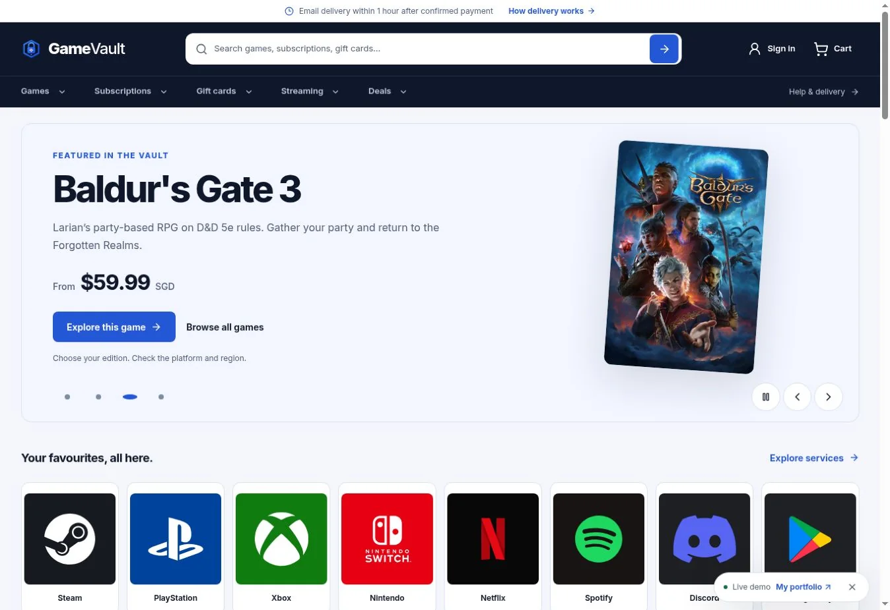

# GameVault

A digital marketplace for game subscriptions, gift cards and games, built with React, Vite, Express and MySQL. The storefront connects product discovery and a sliding cart to server-priced Stripe Checkout and a staff-managed email-delivery workflow.

**[Live storefront](https://gamevault-alpha-ten.vercel.app/)**



## Features

- Responsive catalogue, autocomplete search, category filters and product details with regional eligibility and delivery terms.
- Sliding cart, quantity controls and server-validated discount calculations.
- Stripe Checkout, signed webhooks, payment-to-order verification and duplicate-event handling.
- Protected staff workflows for catalogue publishing, orders and manual email delivery.
- Self-hosted artwork and fonts, light/dark themes and reduced-motion support.

## My contribution

This is an **AI-assisted personal project**. I scoped the marketplace, directed its storefront design, built the React interface and cart, implemented the Vercel API and Express/Sequelize backend, integrated Stripe Checkout and webhook verification, and carried out release verification with AI assistance.

## Stack

React 18, Vite, Tailwind CSS, Node.js, Express, Sequelize, MySQL, Stripe and Vercel Serverless Functions.

## Run locally

Install Node.js and a local MySQL service, then:

```bash
git clone https://github.com/TeddyQyuon/gamevault.git
cd gamevault
npm ci
npm --prefix server ci
cp server/.env.example server/.env
```

Configure the local database and generated secrets in `server/.env`. Keep that file private; provider credentials belong in local or hosting environment settings.

```bash
npm run db:migrate
npm run catalog:prepare
npm run api
```

In a second terminal, run `npm run dev` and open the Vite URL. The staff workspace is at `/admin`; local API configuration is documented in `server/.env.example`.

## Checks

```bash
npm test
npm run api:test
npm run build
npm run lint
npm run api:lint
```

The optional live MySQL integration suite needs its dedicated test configuration. Payment tests use test doubles; a passing local suite does not establish real payment or delivery readiness.

## Operations and limits

Catalogue listings, availability, supplier authority and delivery terms require review before accepting payments. Staff compose and send fulfilment emails themselves; marking an order delivered records the action. Public coder execution routes are disabled.

- [Go-live requirements](docs/GO_LIVE.md)
- [Manual email delivery](docs/MANUAL_DELIVERY.md)
- [Encrypted prepaid-code inventory](docs/PREPAID_CODES.md)
- [Stripe sandbox testing](docs/STRIPE_TESTING.md)
