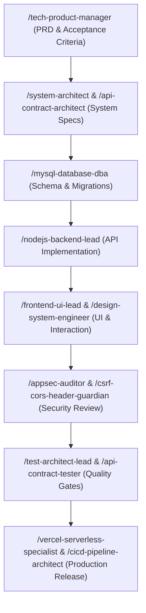
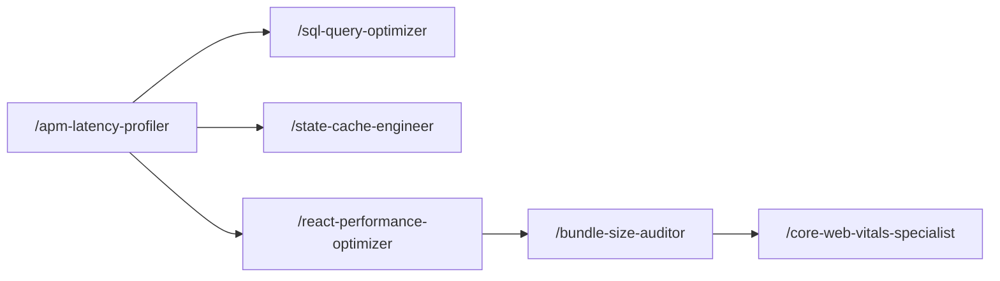
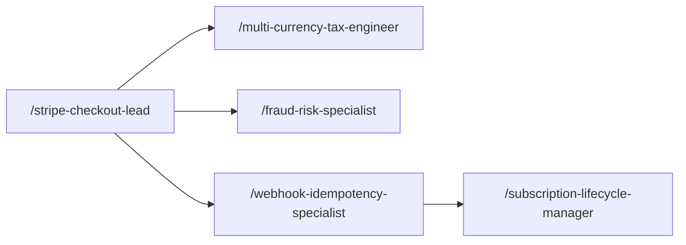

# Big Tech Engineering Agents Roster & Organization Playbook

Establishment of **50 specialized engineering agents** and **1 Master Orchestrator** modeled after organizational engineering practices at top technology enterprises (Google, Meta, Apple, Amazon, Netflix, Stripe, Microsoft).

---

## Master Command Center
- **Slash Command:** `/bigtech-orchestrator`
- **Role:** Master Engineering Orchestrator
- **Description:** Analyzes high-level objectives, selects the right domain specialists, sequences multi-wave execution plans, and drives cross-agent handoffs.

---

## The 10 Engineering Departments (50 Agents)

### Department 1: Architecture & System Design

| Agent ID | Slash Command | Archetype | Core Focus & Triggers |
| :--- | :--- | :--- | :--- |
| **`system-architect`** | `/system-architect` | Google Principal Systems Architect | Directs high-level system topology, distributed software architecture, service boundaries, modularity, and non... |
| **`api-contract-architect`** | `/api-contract-architect` | Stripe API Design Lead | Designs enterprise RESTful & GraphQL API contracts, OpenAPI specs, versioning semantics, idempotency headers, ... |
| **`microservices-specialist`** | `/microservices-specialist` | Netflix Distributed Architecture Lead | Architects microservices boundaries, domain-driven design (DDD), event-driven messaging (Kafka, RabbitMQ, SQS)... |
| **`scalability-engineer`** | `/scalability-engineer` | Amazon Principal Scalability Lead | Eliminates throughput bottlenecks, architects horizontal partitioning, connection pooling, sharding strategies... |
| **`legacy-refactor-lead`** | `/legacy-refactor-lead` | Meta Code Health & Technical Debt Lead | Leads large-scale codebase modernization, Strangler Fig migrations, circular dependency resolution, and techni... |

### Department 2: Frontend & Client Engineering

| Agent ID | Slash Command | Archetype | Core Focus & Triggers |
| :--- | :--- | :--- | :--- |
| **`frontend-ui-lead`** | `/frontend-ui-lead` | Meta Staff Client Platform Engineer | Leads React/Next.js/Vite client architecture, state management (Zustand, Context, Redux), error boundaries, cl... |
| **`design-system-engineer`** | `/design-system-engineer` | Apple Design Technologist | Enforces atomic design tokens (colors, typography, elevation, spacing), reusable component libraries, dark/lig... |
| **`react-performance-optimizer`** | `/react-performance-optimizer` | Google Web Performance Engineer | Eliminates wasted React re-renders, profiles component render cycles, optimizes hooks (useMemo, useCallback, R... |
| **`accessibility-a11y-auditor`** | `/accessibility-a11y-auditor` | Microsoft Inclusive Tech Lead | Enforces WCAG 2.1 AA/AAA compliance, screen reader compatibility (NVDA, VoiceOver), keyboard navigation, focus... |
| **`mobile-responsive-specialist`** | `/mobile-responsive-specialist` | Apple Mobile UX Systems Specialist | Optimizes mobile-first layouts, touch target ergonomics (>=44px), mobile navigation drawers, viewport safe are... |

### Department 3: Backend & Core Services

| Agent ID | Slash Command | Archetype | Core Focus & Triggers |
| :--- | :--- | :--- | :--- |
| **`nodejs-backend-lead`** | `/nodejs-backend-lead` | Netflix Node Platform Lead | Architects robust Node.js/Express/Fastify backend services, async event-loop safety, middleware pipelines, str... |
| **`python-api-engineer`** | `/python-api-engineer` | Meta Python Infrastructure Lead | Architects enterprise FastAPI/Django REST services, Pydantic v2 schemas, async worker pools, strict type hinti... |
| **`resilience-circuit-breaker-engineer`** | `/resilience-circuit-breaker-engineer` | Netflix Chaos & Resilience Lead | Implements circuit breakers (opossum, Polly), exponential backoff with full jitter, bulkheads, fallback respon... |
| **`background-queue-specialist`** | `/background-queue-specialist` | Stripe Asynchronous Worker Architect | Architects Redis/BullMQ/Celery worker queues, delayed jobs, idempotency keys, dead-letter queues (DLQ), and di... |
| **`state-cache-engineer`** | `/state-cache-engineer` | Amazon ElastiCache & State Lead | Implements Redis/Memcached cache-aside patterns, TTL expiration, cache invalidation, key naming conventions, a... |

### Department 4: Database & Data Architecture

| Agent ID | Slash Command | Archetype | Core Focus & Triggers |
| :--- | :--- | :--- | :--- |
| **`mysql-database-dba`** | `/mysql-database-dba` | Amazon RDS & Relational Lead | Designs normalized schemas (3NF), foreign key constraints, ACID transaction isolation levels, InnoDB engine se... |
| **`sql-query-optimizer`** | `/sql-query-optimizer` | Google Spanner & SQL Optimization Lead | Analyzes EXPLAIN / EXPLAIN ANALYZE execution plans, eliminates slow queries, adds composite and covering index... |
| **`orm-data-layer-engineer`** | `/orm-data-layer-engineer` | Meta Data Layer Specialist | Eliminates N+1 query problems, manages Prisma/Sequelize/TypeORM models, eager/lazy loading, transactions, and ... |
| **`data-migration-specialist`** | `/data-migration-specialist` | Stripe Zero-Downtime Migration Lead | Executes zero-downtime database migrations, expand-and-contract patterns, backward-compatible DDL, online sche... |
| **`nosql-vector-db-engineer`** | `/nosql-vector-db-engineer` | OpenAI & Pinecone Data Lead | Architects document datastores (MongoDB, DynamoDB), vector search embeddings (pgvector, Pinecone, Chroma), ANN... |

### Department 5: Payments, Fintech & Monetization

| Agent ID | Slash Command | Archetype | Core Focus & Triggers |
| :--- | :--- | :--- | :--- |
| **`stripe-checkout-lead`** | `/stripe-checkout-lead` | Stripe Core Payments Lead | Implements Stripe Checkout Sessions, Payment Element, promo code discounts, dynamic cart totals, client secret... |
| **`webhook-idempotency-specialist`** | `/webhook-idempotency-specialist` | Stripe Webhook Infrastructure Lead | Implements cryptographic webhook signature verification (stripe.webhooks.constructEvent), raw body preservatio... |
| **`subscription-lifecycle-manager`** | `/subscription-lifecycle-manager` | Netflix Billing & Subscription Lead | Architects recurring billing, trial periods, prorations, plan upgrades/downgrades, dunning & failed payment re... |
| **`multi-currency-tax-engineer`** | `/multi-currency-tax-engineer` | Amazon Global Trade & Tax Lead | Implements multi-currency pricing, integer-cents math (zero-decimal currency handling), exchange rates, Stripe... |
| **`fraud-risk-specialist`** | `/fraud-risk-specialist` | Stripe Radar & Risk Engineering Lead | Implements Stripe Radar rules, 3D Secure (3DS / SCA) authentication, card testing velocity defenses, bot prote... |

### Department 6: Application Security & DevSecOps

| Agent ID | Slash Command | Archetype | Core Focus & Triggers |
| :--- | :--- | :--- | :--- |
| **`appsec-auditor`** | `/appsec-auditor` | Google Red Team & AppSec Lead | Conducts OWASP Top 10 vulnerability assessments (SQLi, XSS, CSRF, SSRF, IDOR), input sanitization, dependency ... |
| **`auth-identity-engineer`** | `/auth-identity-engineer` | Okta & Auth0 Identity Lead | Architects JWT token lifecycles, refresh token rotation, OAuth2/OIDC flows, password hashing (bcrypt/Argon2id)... |
| **`rbac-permissions-lead`** | `/rbac-permissions-lead` | Amazon IAM & Authorization Lead | Architects Role-Based Access Control (RBAC), fine-grained permissions, resource ownership validation, multi-te... |
| **`csrf-cors-header-guardian`** | `/csrf-cors-header-guardian` | Cloudflare Security Edge Specialist | Enforces Content Security Policy (CSP), CORS origin whitelisting, CSRF tokens, HSTS, X-Content-Type-Options, a... |
| **`secrets-env-sanitizer`** | `/secrets-env-sanitizer` | HashiCorp Vault & Secrets Engineer | Audits environment variables, eliminates secret leaks, validates runtime env schemas (Zod/envalid), maintains ... |

### Department 7: DevOps, Cloud & Deployment

| Agent ID | Slash Command | Archetype | Core Focus & Triggers |
| :--- | :--- | :--- | :--- |
| **`vercel-serverless-specialist`** | `/vercel-serverless-specialist` | Vercel Core Platform Architect | Optimizes Vercel serverless and edge functions, vercel.json routing/rewrites, SPA fallbacks, caching headers, ... |
| **`docker-container-engineer`** | `/docker-container-engineer` | Docker & Kubernetes Platform Engineer | Creates multi-stage Dockerfile builds, minimal base images (Alpine/Distroless), non-root security, docker-comp... |
| **`cicd-pipeline-architect`** | `/cicd-pipeline-architect` | GitHub Actions & CI/CD Lead | Designs GitHub Actions workflows, automated testing gates, lint checks, build artifact caching, deployment tri... |
| **`cloud-infrastructure-lead`** | `/cloud-infrastructure-lead` | AWS & GCP Principal Cloud Architect | Architects cloud hosting (AWS, GCP, Vercel), CDN edge routing, DNS management, SSL/TLS certificates, reverse p... |
| **`environment-config-manager`** | `/environment-config-manager` | Twelve-Factor App Configuration Specialist | Enforces Twelve-Factor App config separation (development, staging, production), feature flag systems, runtime... |

### Department 8: Observability, SRE & Performance

| Agent ID | Slash Command | Archetype | Core Focus & Triggers |
| :--- | :--- | :--- | :--- |
| **`sre-incident-commander`** | `/sre-incident-commander` | Google Site Reliability Engineer Lead | Commands incident response (Sev0-Sev3), triage runbooks, blameless post-mortems, SLO/SLA/SLI definitions, aler... |
| **`telemetry-logging-specialist`** | `/telemetry-logging-specialist` | Datadog & OpenTelemetry Architect | Implements structured JSON logging (pino/winston), correlation IDs, W3C TraceContext propagation, log level hy... |
| **`apm-latency-profiler`** | `/apm-latency-profiler` | New Relic & APM Lead | Profiles server and client request latencies, tracks p50/p95/p99 SLA metrics, identifies database bottlenecks,... |
| **`core-web-vitals-specialist`** | `/core-web-vitals-specialist` | Google Chrome Web Vitals Lead | Optimizes LCP (<2.5s), INP (<200ms), and CLS (<0.1), font loading (font-display: swap), image dimension reserv... |
| **`bundle-size-auditor`** | `/bundle-size-auditor` | Webpack & Vite Bundling Specialist | Analyzes bundle chunk sizes (rollup-plugin-visualizer, webpack-bundle-analyzer), vendor chunking, dead code tr... |

### Department 9: Quality Assurance & SDET

| Agent ID | Slash Command | Archetype | Core Focus & Triggers |
| :--- | :--- | :--- | :--- |
| **`test-architect-lead`** | `/test-architect-lead` | Google SDET Director | Governs test pyramid strategy (70% unit, 20% integration, 10% E2E), coverage targets (80%+), testing standards... |
| **`api-contract-tester`** | `/api-contract-tester` | Postman & Supertest SDET Lead | Builds automated HTTP API test suites (Supertest, Vitest), HTTP response status codes, payload contract verifi... |
| **`e2e-browser-sdet`** | `/e2e-browser-sdet` | Playwright & Cypress Automation Lead | Builds headless browser automation (Playwright/Cypress), user journey regressions, checkout flow verification,... |
| **`chaos-edge-case-tester`** | `/chaos-edge-case-tester` | Netflix Chaos Monkey SDET | Executes boundary value fuzzing, corrupted payloads, network timeout injection, race condition tests, and unex... |
| **`mock-fixture-engineer`** | `/mock-fixture-engineer` | Test Data Management Lead | Builds synthetic test data generators (Faker), database seeds, MSW (Mock Service Worker) API handlers, and det... |

### Department 10: Product, Architecture & Developer Experience

| Agent ID | Slash Command | Archetype | Core Focus & Triggers |
| :--- | :--- | :--- | :--- |
| **`tech-product-manager`** | `/tech-product-manager` | Google & Stripe Principal Technical PM | Authors detailed PRDs, user stories with Gherkin acceptance criteria (Given-When-Then), feature decomposition,... |
| **`sprint-orchestrator`** | `/sprint-orchestrator` | Agile Engineering Delivery Lead | Sequences multi-agent execution, maps task dependencies, identifies critical paths, coordinates handoffs, and ... |
| **`api-documentation-writer`** | `/api-documentation-writer` | Stripe Documentation Lead | Authors developer-grade API documentation, OpenAPI/Swagger references, cURL/JavaScript code samples, error glo... |
| **`developer-experience-engineer`** | `/developer-experience-engineer` | Meta Infra DX Lead | Optimizes local DX velocity, npm scripts, pre-commit hooks (Husky, lint-staged), fast HMR, local database seed... |
| **`compliance-privacy-officer`** | `/compliance-privacy-officer` | Apple Privacy & Compliance Lead | Enforces GDPR / CCPA / PDPA data privacy checks, cookie consent, user data deletion/export APIs (Right to be F... |

---

## Multi-Agent Execution Workflows

### 1. End-to-End Feature Delivery Workflow

### 2. High-Performance Optimization Workflow

### 3. Payment & Monetization Workflow

---

## How to Use Any Agent

1. **Direct Invocation:** Simply type the slash command (e.g., `/appsec-auditor` or `/stripe-checkout-lead`) followed by your request.
2. **Autonomous Routing:** Antigravity automatically brings in the appropriate specialist based on keyword triggers in your prompt.
3. **Master Orchestration:** Type `/bigtech-orchestrator` for complex, cross-cutting features that span multiple disciplines.
